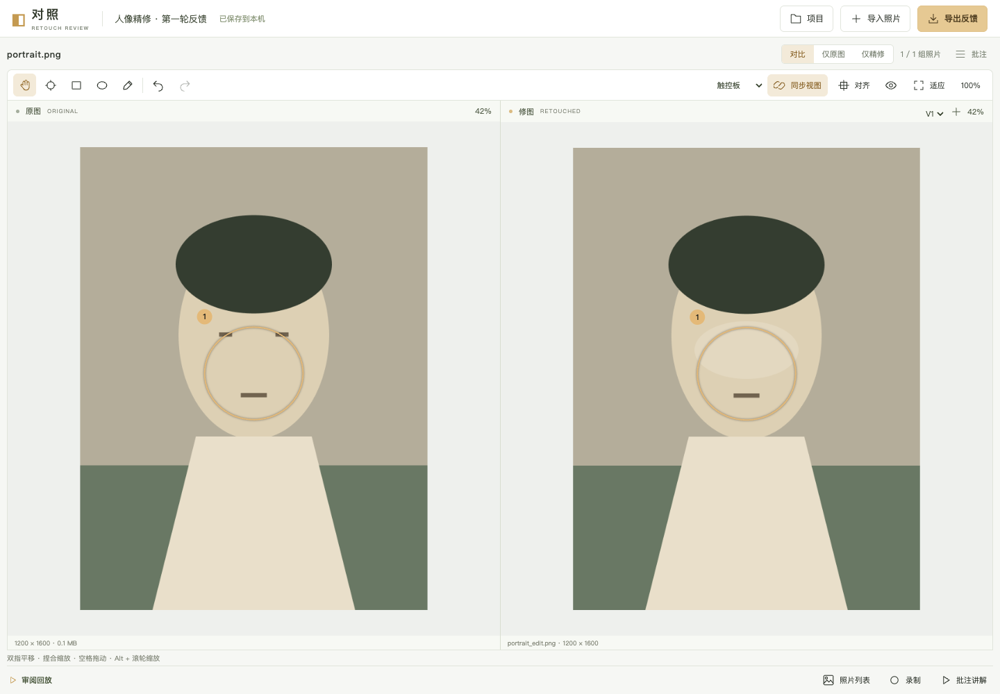
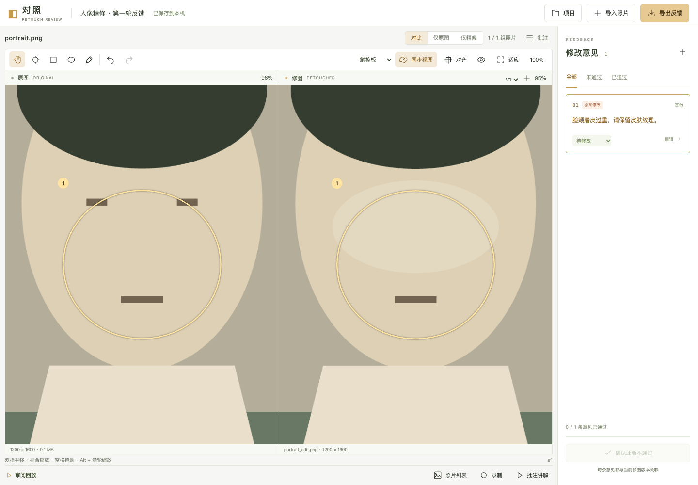
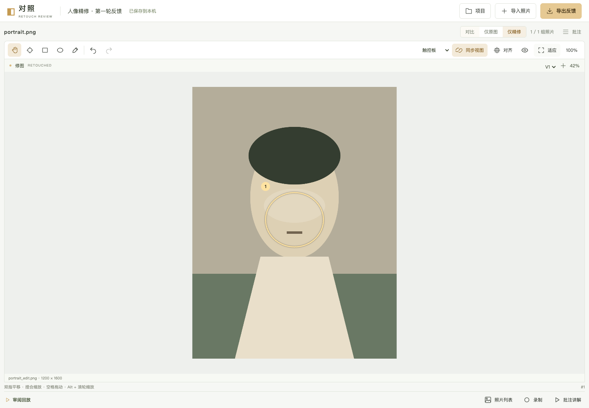

# 对照修图 · Retouch Review

**把照片里的修改意见，说清楚。**

一个在浏览器中运行的照片审阅工具：并排查看原图与精修图，同步放大、平移，圈出需要调整的细节，再把批注与回放导出给后期。

白色工作台 · 本地保存 · 无需登录 · 图片无需上传



> 截图来自实际运行的应用，使用程序生成的示例图片展示功能，不包含用户照片，也不代表真实人像修图验收。

## 适合做什么

- 收到精修照片后，逐张检查肤色、皮肤纹理、五官、服装和背景。
- 把“这里再改一下”变成带位置、编号和说明的修改意见。
- 通过回放让后期按照你的检查顺序理解反馈。
- 收到下一版后，保留上一版记录，逐项确认修改结果。

它是一个**对比与反馈工具**。磨皮、液化、调色等图片编辑仍在修图软件中完成。

## 功能概览

| 能力 | 当前支持 |
| --- | --- |
| 图片导入 | JPEG、PNG、WebP；批量导入；文件名配对建议与手动确认 |
| 对比查看 | 双图对比、仅原图、仅精修；适应窗口与原始像素比例查看 |
| 同步观察 | 两侧同步缩放和平移，也可关闭同步独立观察 |
| 手势操作 | 触控板双指平移、捏合缩放；触屏双指操作；鼠标滚轮缩放模式 |
| 图片对齐 | 平移、旋转、缩放，配合半透明叠加预览 |
| 圈点批注 | 点、矩形、椭圆、自由圈画；整体意见与多个关联区域 |
| 批注联动 | 点击画布标记，展开侧栏并定位、高亮对应卡片 |
| 复核管理 | 分类、优先级、待修改／待复核／已通过状态；保留多轮版本 |
| 回放 | 自动批注讲解、主动录制审阅操作、暂停、章节跳转与播放速度 |
| 本地保存 | 自动保存、项目切换、文字草稿暂存、项目包备份与恢复 |
| 反馈导出 | PNG、PDF、离线 HTML 回放、可编辑 `.retouch` 项目包 |

对比画布占据主要空间，批注面板和照片列表默认折叠，需要时再展开。

## 界面预览

### 位置与意见一一对应

点击图片上的编号或圈选区域，右侧自动打开对应卡片。可以填写修改说明、设置优先级，并跟踪复核状态。



### 专注查看一张照片

通过右上角的“对比 / 仅原图 / 仅精修”切换查看方式。单图模式使用完整画布，保留批注和观察位置。



## 快速开始

推荐使用 **Node.js 22.12 或更新版本**，项目已在 Node.js 22.22.1 下验证。

在项目目录执行：

```bash
npm ci
npm run dev -- --port 5178
```

打开 [本地工作台](http://127.0.0.1:5178/)。开发服务默认只监听本机。

构建并预览生产版本：

```bash
npm run build
npm run preview
```

预览地址以终端输出为准，默认是 [http://127.0.0.1:4173](http://127.0.0.1:4173/)。

## 完成一次审阅

1. **导入原图**：创建照片组。支持一次选择多张图片。
2. **导入修图**：检查配对建议，手动确认每张修图对应的原图。同一原图可以追加多个精修版本。
3. **对照细节**：放大、平移，或切换单图查看。如果构图有裁切或旋转，先使用“对齐”。
4. **圈出位置**：选择标记工具，画出区域，再填写修改说明。整体色彩等问题可以添加无局部区域的意见。
5. **整理反馈**：在批注卡片中设置分类、优先级和状态。点击标记可重新定位卡片。
6. **预览回放**：选择“批注讲解”自动生成讲解，或用“录制”保存自己的检查过程。
7. **导出交付**：生成对比图、PDF 或离线回放；另外保存一份项目包，便于继续审阅。

### 手势与快捷键

工具栏提供输入设备选择，默认使用“触控板”模式。

| 操作 | 效果 |
| --- | --- |
| 触控板双指滑动 | 平移画面 |
| 触控板捏合 | 围绕手势位置缩放 |
| 触屏双指拖动／捏合 | 平移／缩放；进入双指手势时取消未完成的单指圈画 |
| 鼠标模式下滚轮 | 缩放画面 |
| `Alt` + 滚轮 | 缩放画面 |
| 手形工具拖动 | 平移画面 |
| 按住 `Space` 拖动 | 临时切换为平移 |
| `H` / `P` / `R` / `O` / `B` | 平移／点标记／矩形／椭圆／自由圈画 |
| `⌘ / Ctrl + Z` | 撤销 |
| `Shift + ⌘ / Ctrl + Z` | 重做 |

原图与精修分辨率不同时，同步查看优先保持对应内容的显示尺度一致，两侧实际像素比例可能不同。

### 两种回放

**批注讲解**根据当前照片和批注生成：先展示全图，再定位每条意见。无需提前录制；每条意见的停留时间可以在编辑器中调整。

**审阅录制**在主动点击“录制”后开始，保存照片切换、缩放、平移、标记等操作。支持暂停和结束，历史录制使用独立快照，不会因后续编辑批注而改变。不包含声音、摄像头或桌面录屏。

### 多轮精修

修图以 V1、V2 等版本保留，批注绑定具体版本。切换到空白新版本时，可以复制前一版本未通过的意见，作为待复核项。

继承的区域需要重新检查定位；局部液化等变化可以在批注编辑器中单独指定另一侧位置。只有用户确认后，意见才会变为“已通过”。

## 导出什么文件

| 格式 | 适合用途 | 包含内容 |
| --- | --- | --- |
| PNG | 在聊天中发送 | 双图对照、标记编号和修改说明；多张照片打包为 ZIP |
| PDF | 集中交付反馈 | 全图概览、局部放大对照、批注详情 |
| HTML | 让接收方回放查看 | 内嵌图片、批注、播放器；无需联网 |
| `.retouch` | 备份、换电脑、继续编辑 | 原始图片、精修版本、批注、对齐参数、录制与资源校验信息 |

反馈支持按当前照片、选定照片或整个项目导出，并选择全部意见或仅未通过项。项目包始终备份完整项目；选择历史录制导出 HTML 时，保留该段完整录制。

恢复备份：打开“项目”→“导入项目包”，选择 `.retouch` 文件。导入会验证资源校验信息，并创建一份导入后的项目。

## 保存与隐私

- 图片和项目保存在当前浏览器的 **IndexedDB**，文字草稿暂存在本地存储中。
- 不需要账号，没有服务端图片上传接口。
- 本地数据与浏览器及站点地址绑定。更换浏览器、端口或域名后，需要通过项目包迁移。
- 清理站点数据可能移除项目；浏览器本地保存不能替代备份，请定期导出 `.retouch`。
- 项目包保留源文件，可能包含原有拍摄元数据。PNG、PDF 和 HTML 使用重编码的展示图片。
- 单张导入限制为 **30 MB、2400 万像素**。RAW、PSD、HEIC 等格式请先转换。

## 开发与验证

| 命令 | 用途 |
| --- | --- |
| `npm run dev -- --port 5178` | 启动本地开发服务 |
| `npm run build` | TypeScript 检查并构建到 `dist/` |
| `npm run preview` | 预览生产构建 |
| `npm run typecheck` | 类型检查 |
| `npm test` | 坐标映射、手势、批注命中、回放和项目校验测试 |
| `node tests/browser.mjs` | 浏览器交互及导出恢复测试 |

浏览器测试要求先启动 **5178** 端口的服务。目前测试脚本使用 macOS 上的 Google Chrome 路径；其他环境需调整 `tests/browser.mjs` 中的 `executablePath`。

测试在隔离浏览器中生成示例图片，不读取用户照片。截图、导出文件等临时产物写入已忽略的 `artifacts/`。

### 更新 README 截图

```bash
# 保持 5178 端口的开发服务运行
node tests/browser.mjs
node scripts/screenshots.mjs
```

截图脚本使用测试生成的示例项目，在隔离浏览器中生成 `docs/screenshots/` 下的三张截图。可通过 `CHROME_PATH` 环境变量指定截图脚本使用的浏览器路径。文档图片随仓库保存，不依赖外链图床。

### 实现结构

使用 **TypeScript + Vite + Canvas 2D**，以 IndexedDB 保存本地数据；Zod 校验导入结构，JSZip 处理项目包，jsPDF 生成反馈文档。

```text
src/
├── main.ts              工作台、配对、版本与批注交互
├── model.ts             数据模型及项目校验
├── geometry.ts          图像坐标、对齐和视图变换
├── gestures.ts          触控板、鼠标与触屏手势
├── hit-test.ts          画布批注命中检测
├── renderer.ts          图片与标记渲染
├── storage.ts           本地存储、图片缓存与项目包
├── replay.ts            讲解时间轴和录制回放
├── exports.ts           PNG、PDF、HTML 导出
├── offline-player.js    导出 HTML 内的独立播放器
└── style.css            白色工作台及响应式布局
tests/                   核心逻辑与浏览器测试
scripts/screenshots.mjs  文档截图生成脚本
docs/                    PRD、验证记录和截图
```

## 当前边界

这是可运行的首版。构建、核心测试和本机 Chrome 自动流程已经通过，但尚未完成真实照片与所有浏览器验收。

- 实际 Mac 触控板手感、Safari、Edge、真实手机与大批量高分辨率照片，仍需进一步验证。
- 色彩描述文件、复杂裁切和液化、存储不足等边界场景，仍需真实样本检查。
- 区域位置和大小目前通过批注编辑器的数值调整，尚无画布拖拽控制点。
- 自定义排序、回放镜头插值和大项目自动拆分 HTML 尚未完成。
- 视频导出、在线分享和多人协作属于后续规划。

详见 [产品需求文档](docs/PRD.md) 与 [验证记录](docs/VALIDATION.md)。
